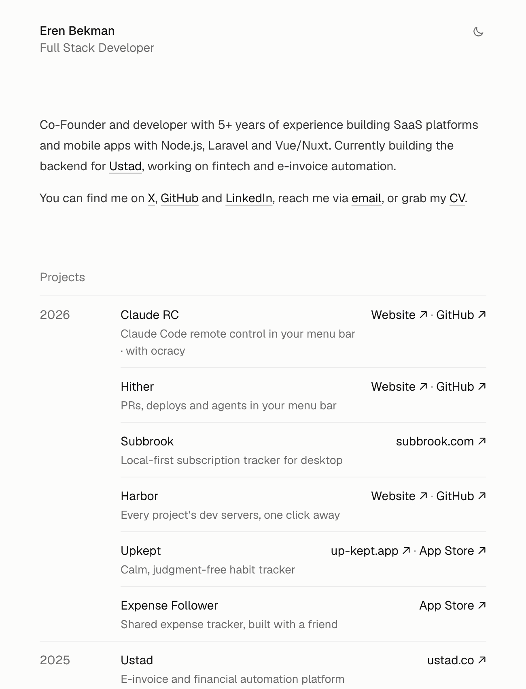

# erenbekman.com

Personal site of Eren Bekman: projects, experience and CV.

Plain HTML and CSS, no build step. Deployed on Cloudflare Pages from `main`.

- `index.html` — the site, with light and dark themes
- `cv.html` → `Eren-Bekman-CV.pdf` — CV source and the rendered PDF
- `og.html` → `og.png`, `icon.html` → `favicon.png` — sources for the share card and icons

**[erenbekman.com →](https://erenbekman.com)**
